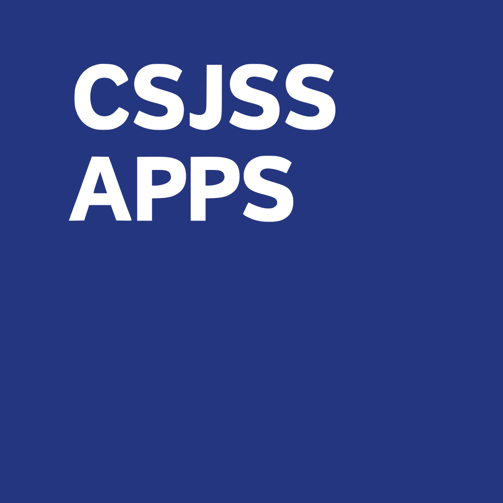
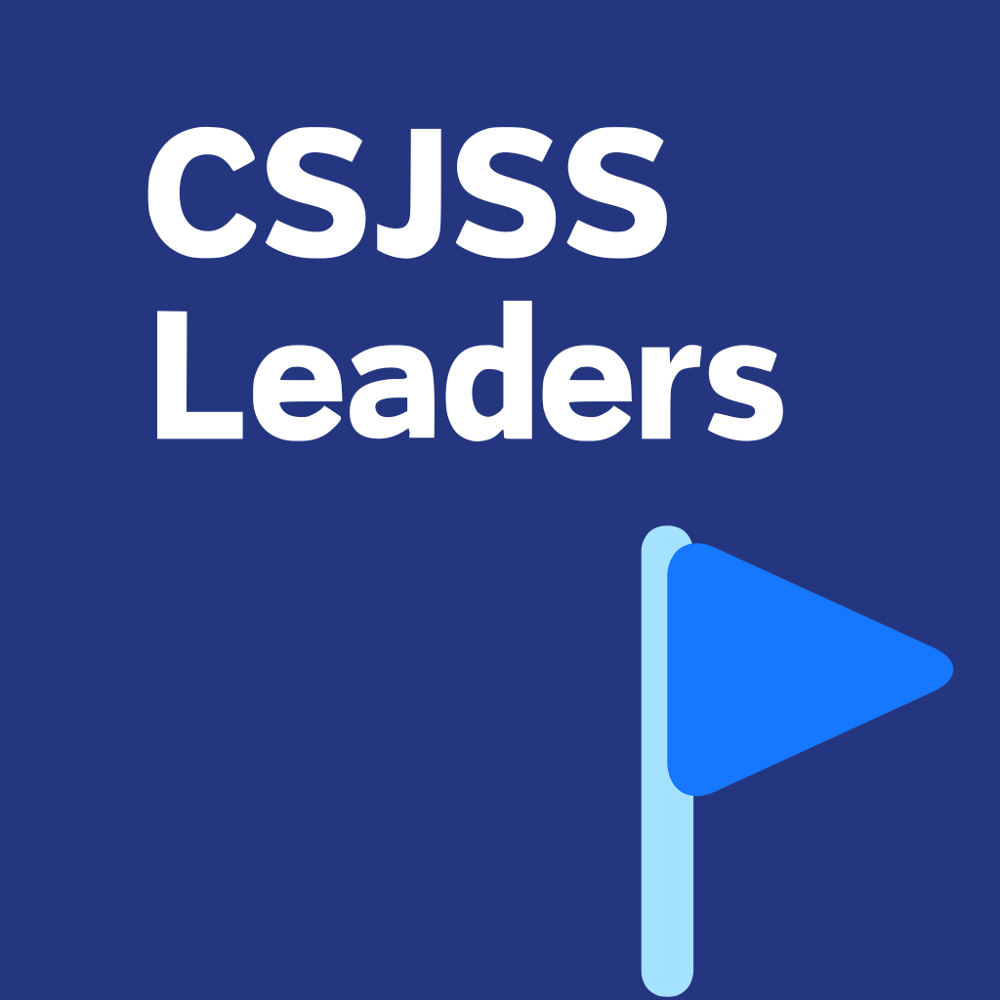
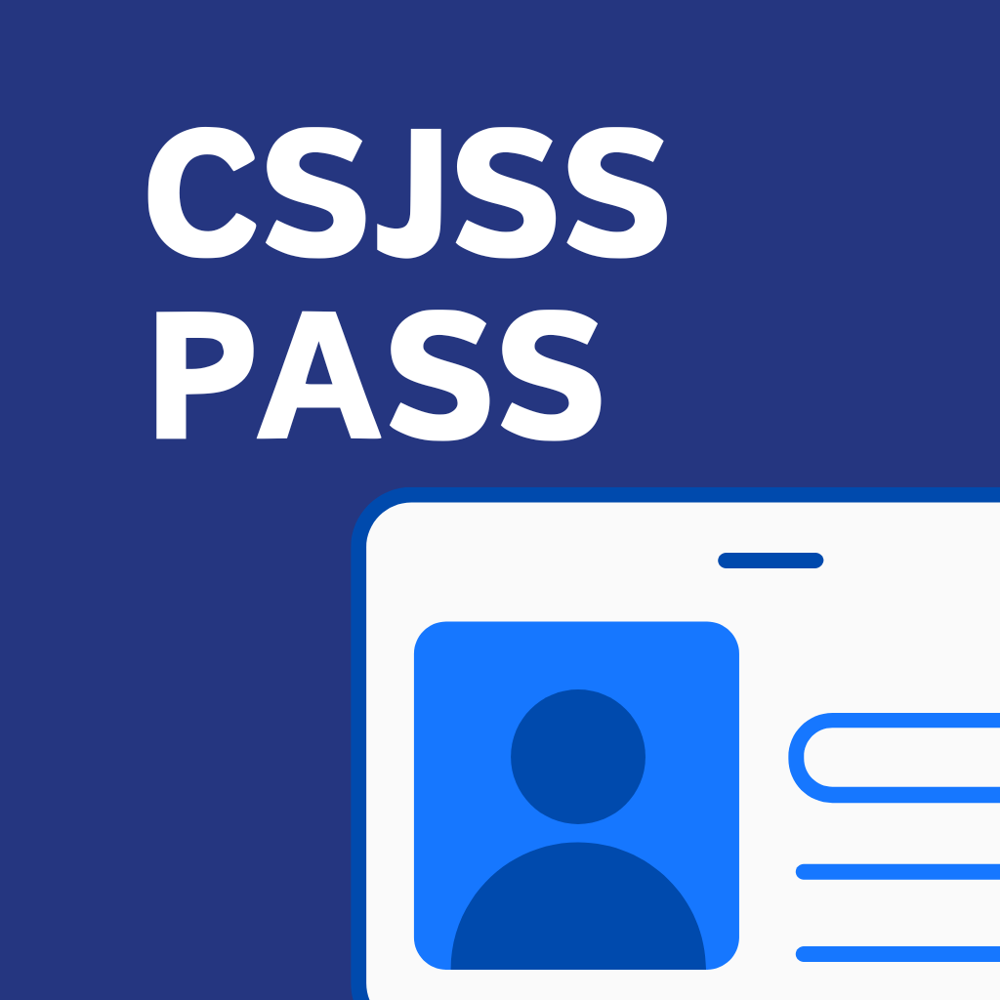
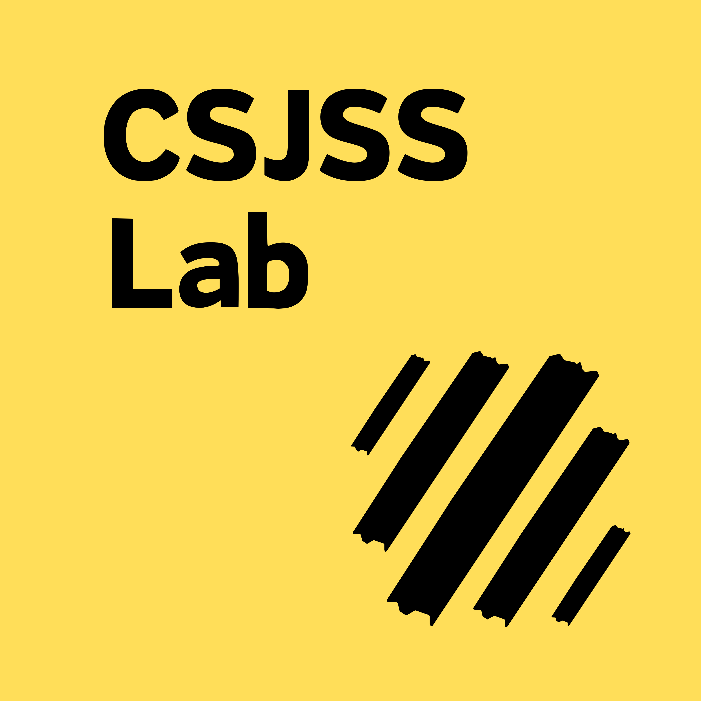
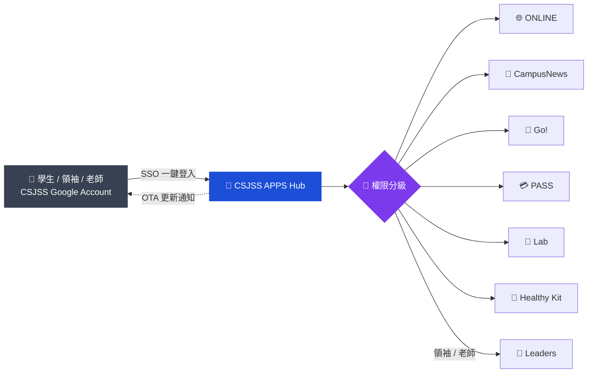

 

  

&nbsp;

&nbsp;

&nbsp;

&nbsp;

&nbsp;

&nbsp;

&nbsp;

  

  

**明愛聖若瑟中學專屬軟體發佈平台 & 數位校園生態系**

 

[English](./README_EN.md) | **繁體中文** | [粵語版本](./README_HK.md)

 

[應用矩陣](#apps) · [平台架構](#architecture) · [運行狀態](#status) · [CSJSS PASS](#pass) · [CSJSS Lab](#lab) · [安裝部署](#deploy) · [貢獻者](#credits)

---

## 📱 應用矩陣 (App Matrix)

**CSJSS APPS** 不僅是一個下載器，它是整合全校數位資源的指揮中心，以下是目前託管的核心應用：

| 應用名稱 (App Name) | 類別 (Category) | 主要功能 (Key Features) |
| :--- | :---: | :--- |
| **🌐 CSJSS ONLINE** | `Web Portal` | 學校官網的原生 App 化封裝，支援重要公告推播通知 |
| **👔 CSJSS Leaders** | `Management` | **領袖/老師專用**，發佈當值時間表，管理學生秩序紀錄 |
| **📰 CSJSS CampusNews** | `Media` | **學生自製新聞台**，支援圖文編輯，影片上傳與即時評論互動 |
| **🏃 CSJSS Go!** | `Activity` | 校內活動報名，House (社) 比賽積分查詢，ECA 資訊匯總 |
| **💳 CSJSS PASS** | `Digital ID` | **旗艦功能**，整合 Apple Pay / Google Pay 的數位學生證 |
| **🧪 CSJSS Lab** | `Education` | 實驗室安全守則，**AR/VR 科學實驗模擬遊戲** |
| **🏥 CSJSS Healthy Kit** | `Health` | 基於 EazyUI 自研架構與 MIT App Inventor 開發的智能健康監測 APP，依賴 iRED 公司開發的 Smart Learning HEALTH KIT 硬件 |

---

## 🧩 平台架構 (Architecture Overview)

---

## 📊 平台運行狀態 (Store Status)

### ✅ 核心服務 (Core Services)

| | 服務 | 說明 |
| :---: | :--- | :--- |
| 🔑 | **統一身份認證 (SSO)** | 一鍵登入所有 CSJSS 系列 App，無需重複輸入帳號 |
| 🔄 | **OTA 自動更新** | 當子應用有新版本時，商店會自動推送更新消息 |
| 🛡️ | **權限分級** | 自動識別使用者身份（登錄 CSJSS Google account）（學生/領袖/老師），解鎖對應 App 下載權限 |
| 📱 | **跨平台支援** | 完美適配 iOS (IPA) 與 Android (APK) 環境 |
| 🧪 | **Beta 測試版軟件分發** | 可提前試用還在開發階段的 APP |

> [!NOTE]
> CSJSS APPS 在 iOS 中並不需要 APP，所以在商店頁面會切換為一套 APP 整合。

### ⚠️ 已知問題 (Known Issues)

| 應用 | 狀態 |
| :--- | :--- |
| 🧪 **CSJSS Lab** | 💭 僅停留於概念階段 |
| 📰 **CSJSS CampusNews** | 💭 僅停留於概念階段 |
| 🌐 **CSJSS ONLINE** | 💭 僅停留於概念階段 |
| 👔 **CSJSS Leaders** | 💭 僅停留於概念階段 |
| 🏃 **CSJSS Go!** | 💭 僅停留於概念階段 |
| 💳 **CSJSS PASS** | 🚧 開發緩慢及受阻 |

---

## 💳 CSJSS PASS 核心亮點 (Spotlight)

**將你的學生證放入手機錢包，體驗無感通行的便利**

| 👛 Wallet Integration 原生錢包整合 | 📲 Tap to Check-in NFC 拍卡 | 🔒 Security 安全驗證 |
| :--- | :--- | :--- |
| 支援一鍵加入 **Apple Wallet** (iPhone/Apple Watch)  支援一鍵加入 **Google Wallet** (Android) | 早上進校時，無需解鎖手機或開啟 App，直接透過 **NFC 感應** 記錄到校時間  圖書館借書、實驗室簽到、校內小食部身份驗證一拍即合 | 動態加密 QR Code，杜絕截圖借用與身份盜用 |

👉 **更多訊息請移步至 [CSJSS-PASS 倉庫](https://github.com/AriesLinux/CSJSS-PASS)**

---

## 🧪 CSJSS Lab 創新體驗 (Innovation)

**打破物理限制，將科學實驗室裝進口袋**

| 📚 安全守則資料庫 | 🔬 AR 元素週期表 | 🥽 VR 虛擬實驗 |
| :---: | :---: | :---: |
| 實驗前必讀指南，內建測驗功能，通過後方可解鎖實體實驗室進入權限 | 使用手機鏡頭掃描課本圖片，3D 懸浮顯示化學元素特性與結構 | 模擬危險化學反應（如鈉與水反應、強酸稀釋），讓同學在安全環境下觀察劇烈反應現象 |

> [!NOTE]
> CSJSS Lab 目前仍停留於概念階段。

---

## ⚙️ 安裝與部署 (Deployment)

> [!IMPORTANT]
> **由於這是校內專用商店，請依照以下步驟安裝：**

| 步驟 | 操作 | 說明 |
| :---: | :--- | :--- |
| **1** | 📥 **下載安裝包** | 前往校網下載 `CSJSS_Store_Installer`（iOS 描述檔 或 Android APK） |
| **2** | 🔏 **信任企業憑證 (iOS)** | 設定 → 一般 → VPN 與裝置管理 → 信任 `Caritas St. Joseph Secondary School` |
| **3** | 🔑 **身份登入** | 使用學校 Google 帳號（`@csjss.edu.hk`）登入商店，系統將自動派發對應權限 |
| **4** | 🚀 **一鍵部署** | 點擊首頁的 "Install All Essential Apps" 即可批量下載所有必備工具 |

---

## 👏 開發貢獻者 (Credits)

| 角色 | 負責方 |
| :--- | :--- |
| 🧭 **Project Lead** | CSJ IT 部 |
| 🧪 **CSJSS Lab** | Science Society & STEM 部（提供科學內容與 VR 建模） |
| 🎨 **UI/UX Design** | EazyUI |

---

**CSJSS APPS - Empowering Campus Life with Tech.**

發現 Bug？請透過 CSJSS Go! 內的「意見反饋」功能回報

